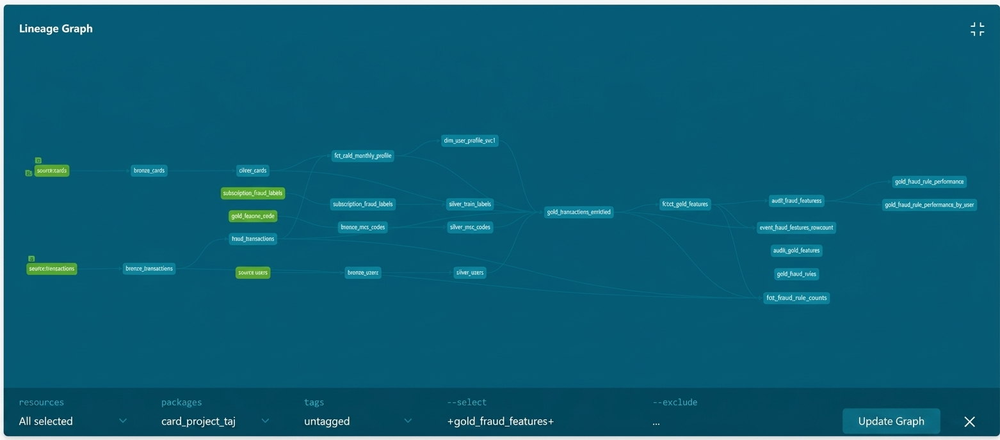

# Credit Card Reconciliation and Fraud Detection (Databricks + dbt)

A medallion-architecture (bronze, silver, gold) pipeline built with dbt on Databricks. It cleans 13.3M credit card transactions, tracks card history with a Type 2 slowly changing dimension, measures rule-based fraud detection with time-based evaluation, and runs internal reconciliation checks.

 

## Data

Source files sit in a Databricks volume (`/Volumes/card_project/source/project_files`).

| File | Content | Size |
|---|---|---|
| `transactions_data.csv` | Card transactions, 2010-01-01 to 2019-10-31 | 13,305,915 rows |
| `cards_data.csv` | Card attributes | 6,146 cards |
| `users_data.csv` | Cardholder attributes | 2,000 users |
| `train_fraud_labels.json` | Fraud label per transaction (`Yes`/`No`) | 8,914,963 labels |
| `mcc_codes.json` | Merchant category codes | 109 codes |

Fraud is rare: 13,332 of 8,914,963 labeled transactions (0.15%). Labels cover about 67% of transactions; the other 4,390,952 are unlabeled and are used for history features and reconciliation only.

## Architecture

| Layer | Schema | Built by | Contents |
|---|---|---|---|
| Raw | `card_project.bronze` | SQL (`read_files`), run once | The five files as Delta tables, all columns as strings, with load timestamp and source file |
| Bronze | `card_project.bronze` | dbt views (`bronze_*`) | One view per raw table |
| Silver | `card_project.silver` | dbt tables | Typed and cleaned data (`silver_*`) and `int_card_monthly_profile` |
| Gold | `card_project.gold` | dbt tables | Enriched transactions, SCD2 dimension, fraud features and rules, reconciliation models |

A custom `generate_schema_name` macro makes dbt build into the schema names exactly (`bronze`, `silver`, `gold`) instead of prefixing them with the target schema.

Privacy: card numbers are reduced to the last 4 digits in silver, the CVV is dropped, and the user address is dropped. The raw layer still holds the original columns, so restrict access to it.

## Key design decisions

**Type 2 dimension on derived attributes.** The source has one row per card, so there is no real history to track. The dimension (`dim_card_profile_scd2`) is built from a monthly card profile derived from transaction history, with business effective dates (`valid_from`, `valid_to`, half-open ranges). Gold joins each transaction to the profile row valid on its date, so features describe the card as it was at that time.

**The risk tier is a monthly snapshot, not part of the SCD2.** A first version tracked the risk tier in the dimension and produced a median of 8 versions per card (up to 47) because the tier flipped month to month. Moving it to the monthly snapshot (`int_card_monthly_profile`) left the dimension tracking only `card_status` and `credit_limit`: 4,066 of 4,071 cards now have 1 to 3 versions.

**No look-ahead.** The risk tier and all behaviour features use only earlier rows. Fraud labels are never used to build features.

**Time-based evaluation.** Rules are designed on data up to 2018 and scored once on 2019 (`train_cutoff_date` defaults to 2018-12-31, set with `--vars`). A random split would have hidden the drift described below.

## Fraud detection findings

The fraud pattern changed over time, and rules built from all labeled data failed on the most recent year.

- **Online fraud dominated through 2016, then disappeared.** Online transactions held 66% of all labeled frauds, and 2,096 frauds in 2016 alone. There were 0 online frauds in 2017 and 0 in 2019. In 2019, 1,238 of the 1,360 frauds (91%) were chip transactions.
- **Online-era rules (r1, r2, r4, r5) worked until 2016 and then stopped.** Combined ("any rule"), they caught 48% of frauds at 3.3% precision over 2010 to 2016. They caught 0 frauds in 2017 and 0 in 2019.
- **r3 (burst activity) was dropped.** Its 2019 precision (0.17%) matched the base rate.
- **r6 (chip transaction at a merchant the card first used within the last 30 days) held up:**

| Year | Flagged | Frauds caught | Precision | Recall (all frauds) |
|---|---|---|---|---|
| 2017 | 33,793 | 117 | 0.35% | 68.0% |
| 2018 (design year) | 32,059 | 957 | 2.99% | 58.7% |
| 2019 (test) | 26,005 | 819 | 3.15% | 60.2% |

  That is roughly 14 times the chip base rate in each of the three years. Caveat: I had seen the 2019 fraud mix (mostly chip) before choosing to look at chip, so the 2019 test is not perfectly clean. The merchant feature and the 30-day window came only from 2018 and earlier.
- **A card's recent new-merchant count is a strong signal.** In 2018 chip transactions at known merchants, the fraud rate rose from 0.019% (no new merchants in the prior 7 days) to 0.977% (3 or more). It is kept as a model feature (`new_merchants_prior_7d`, `new_merchants_prior_30d`).
- **The error-history risk tier is a weak predictor**, and it was not tuned against the labels, to avoid leaking them.

## Fraud model

A gradient-boosted classifier (scikit-learn `HistGradientBoostingClassifier`) sits beside the rule baseline. Notebook: `notebooks/fraud_model_notebook.py`. It uses the same time-based protocol as the rules: train through 2017, tune on 2018, refit through 2018 and score 2019 once. Training keeps every fraud row and 10% of legitimate rows; every evaluation uses all labeled rows of the test year. The model is compared with rule r6 at the same flag rate (3.3% of transactions), so the review workload is identical.

| 2019 test | Frauds caught | Precision | Recall |
|---|---|---|---|
| Rule r6 | 819 | 3.15% | 60.2% |
| Model | 1,160 | 4.46% | 85.3% |

The model catches 341 more frauds for the same number of flagged transactions (PR-AUC 0.354 against a base rate of about 0.17%).

**Drift.** Training only on earlier years, the model beats r6 in 2016 (6.79% against 0.50% precision) and 2018 (3.88% against 2.99%), but ties it in 2017 (0.36% against 0.35%), the year fraud moved from online to chip. A model learns a new fraud type only after it appears in training data, which is the case for regular retraining.

**What drives it.** Merchant category and transaction type matter most, followed by merchant familiarity (days since first visit, new merchants in the prior 7 days) and hour of day. Error history and the risk tier contribute little. The three hyperparameter settings tried gave nearly identical results (PR-AUC 0.193 to 0.204), so the outcome does not depend on tuning.

**Caveats.** Precision is still low in absolute terms (about 95% of flagged transactions are legitimate), as expected for 0.17% fraud. Importance scores are approximate because several features are correlated. The 2019 fraud mix was seen when rule r6 was designed, which slightly favours the rule; the model's settings were chosen on 2018 only.

## Reconciliation

The dataset has no second source (such as a bank settlement file) to compare against, so reconciliation means internal controls and exception checks.

- **Control totals.** A test checks that transaction counts and total amounts tie between bronze, silver, gold enriched, gold features and the card-month statement.
- **Exceptions** (`gold_recon_exceptions`, one row per transaction and issue):

| Exception | Severity | Count |
|---|---|---|
| Card used after expiry | high | 83 |
| Card used before account open | high | 309 |
| Possible duplicate (same card, merchant and amount within 60 seconds) | high | 2,141 |
| Possible duplicate (within 10 minutes) | medium | 9,334 |
| Refund with no earlier purchase at the merchant | medium, | 2,527 |
| Same, refund dated in 2010 (purchase may predate the data window) | low, | 1,659 |

- **Refund matching** (`gold_recon_refund_matches`): of 660,049 refunds, 538,423 match an earlier purchase of the same amount, 117,440 match an earlier purchase at the same merchant with a different amount (partial refunds), and 4,186 have no earlier purchase. Refunds in 2010 are overrepresented because their purchases may predate the data window. Of the 4,186, the 1,659 dated 2010 are rated low severity and the other 2,527 medium.
- **Card-month statement** (`gold_recon_card_month_statement`): purchases, refunds, net and error counts per card per month.
- **Unused cards** (`gold_recon_unused_cards`): 2,075 of 6,146 cards never appear in a transaction.
- **Integrity:** no transaction has a card belonging to a different user.
- **Exceptions are not fraud signals in this data.** Only 2 frauds appear among 10,837 labeled exception rows (0.018%, below the 0.15% base rate).

## Assumptions

- Transactions with an error code are still recorded. The statement reports both `net_amount` (everything) and `settled_net_amount` (excluding error rows).
- Duplicate windows are variables: `dup_high_secs` (default 60) and `dup_medium_secs` (default 600).
- `data_warmup_end` (default 2011-01-01) marks refunds before that date as low severity when no purchase is found.
- Card status is derived from `expires_date` and recent activity. `card_on_dark_web` is a current-day value, so it is not applied to history.

## Running it

1. In Databricks, create the schemas and load the raw tables from the volume (SQL with `read_files`, all columns as strings).
2. Install `dbt-databricks` and set up a profile pointing at a SQL warehouse (catalog `card_project`).
3. Build everything and run all tests:

```
dbt build
```

Optional variables, for example a different train/test cutoff:

```
dbt build --select gold_fraud_features+ --vars "{train_cutoff_date: '2018-06-30'}"
```

## Tests

A full `dbt build` runs 63 nodes (models and tests): unique, not-null, relationship and accepted-value tests, plus singular tests for SCD2 integrity (no overlapping ranges, no gaps, one current row per card), the feature row count, the layer control totals, and unique reconciliation keys.

## Limitations and next steps

- Reconciliation is internal only. With a settlement or statement file, the exceptions would turn into true matched/unmatched breaks.
- Fraud model: add regular retraining and monitoring for drift, and test hour of day as a new rule.
- The SQL uses Spark/Databricks functions (`stack`, `try_to_date`, `<=>`, `sequence`), so moving to another engine means rewriting parts of it. Moving to Databricks on AWS mainly means moving the raw files to S3 and changing catalog and warehouse settings, which are kept in dbt variables and sources.

## Repository layout

```
macros/generate_schema_name.sql
models/
  source/sources.yml
  bronze/      bronze_* views
  silver/      silver_* tables, int_card_monthly_profile
  gold/        enriched, SCD2, fraud and reconciliation models
tests/         singular tests
```
